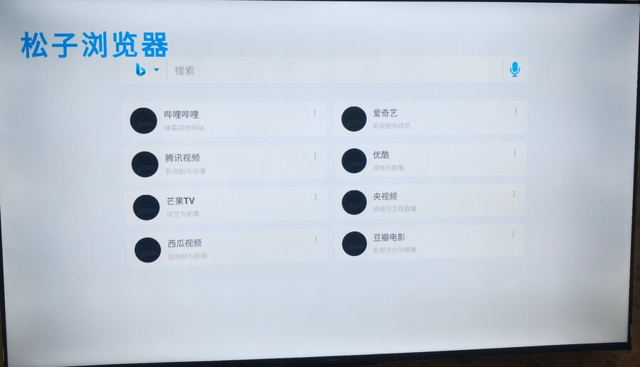
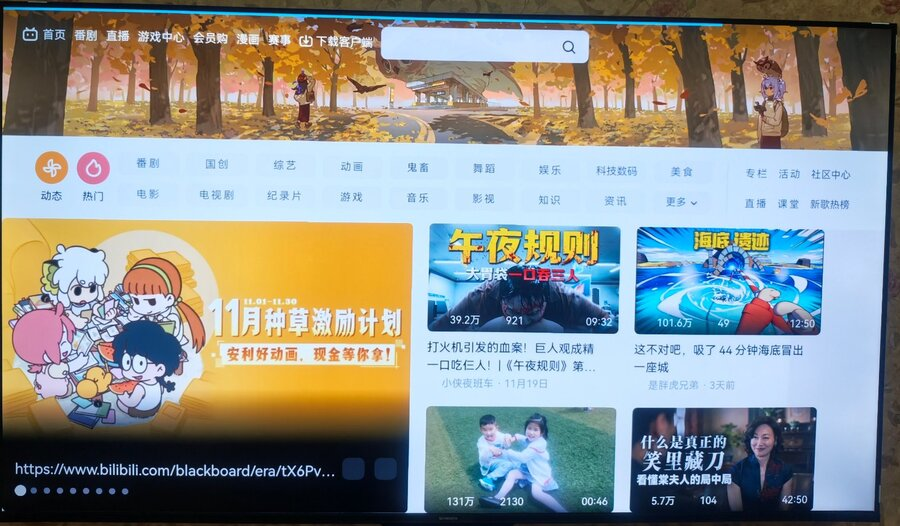
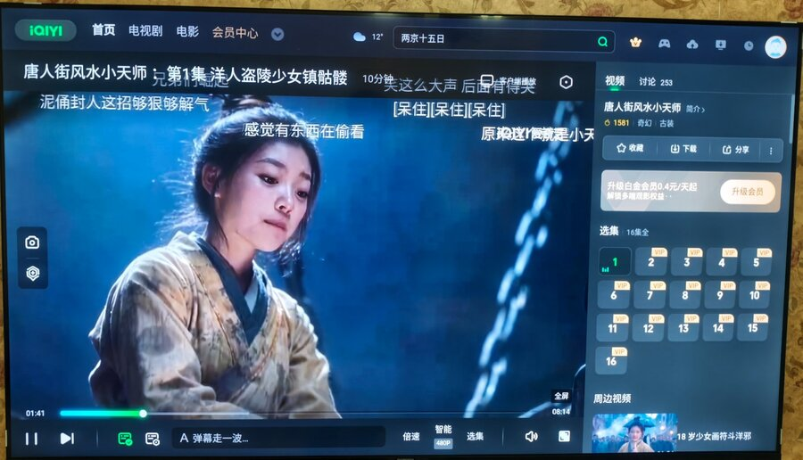
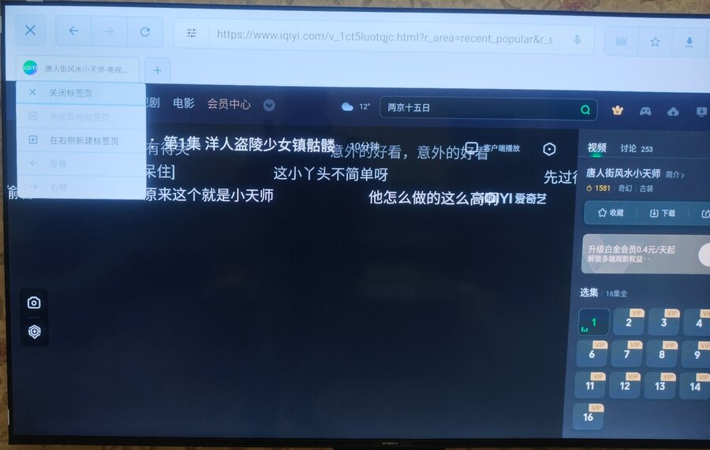
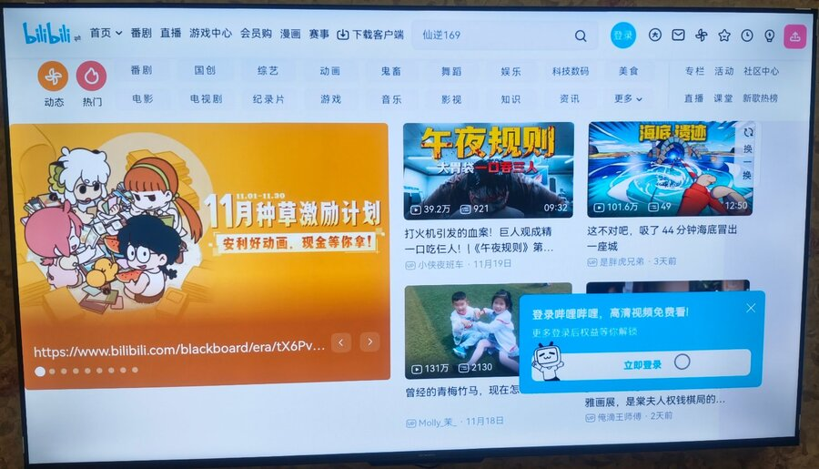

<div align="center">
  
  <br><sub>金色松子 + 播放三角：一颗"能看视频的松子"</sub>
</div>

# 松子浏览器（Songzi Browser）

**一款为电视遥控器深度优化的 Android 浏览器 —— 大屏冲浪，一按即达。**

松子浏览器基于开源项目 [TV Bro](https://github.com/truefedex/tv-bro) 修改而来，默认面向国内用户：首页预置主流视频站点，方向键即可完成全部浏览操作，并针对国内视频网站的播放与独占控制做了专门适配。应用名称、图标与包名均已独立，未使用 TV Bro 的商标与标识。原作者的版权声明、许可条件与免责声明完整保留在 [LICENSE.md](LICENSE.md)。

<div align="center">

| Android 5.0+ | WebView 引擎 | 中文优化 | 开源协议 |
|:---:|:---:|:---:|:---:|
| minSdk 24 | 基于系统内核 | 国内站点首页 | BSD-3-Clause |

</div>

---

## 实拍预览

<div align="center">
<table>
  <tr>
    <td align="center"><b>首页 · 遥控器友好布局</b><br></td>
    <td align="center"><b>爱奇艺 · 弹幕播放</b><br></td>
  </tr>
  <tr>
    <td align="center"><b>爱奇艺 · 剧集播放与弹幕</b><br></td>
    <td align="center"><b>哔哩哔哩 · 首页适配</b><br></td>
  </tr>
  <tr>
    <td align="center"><b>爱奇艺 · 选集与播放控制</b><br></td>
    <td align="center"><b>标签页长按菜单 · 关闭 / 新建 / 移动</b><br></td>
  </tr>
  <tr>
    <td align="center" colspan="2"><b>哔哩哔哩 · 完整网页功能（登录弹窗等）</b><br></td>
  </tr>
</table>
</div>

> 以上均为电视实拍：从首页一点直达视频网站，弹幕、选集、倍速、标签页管理等完整网页功能在电视上均可正常使用。

---

## 核心特性

### 为遥控器而生

- **方向键导航**：D-pad 逐项聚焦页面元素，不依赖触屏；支持游戏手柄摇杆连续导航。
- **虚拟光标**：方向键移动光标，可在任意坐标精确点击网页，适配没有鼠标的电视场景；支持光标加速与边缘自动滚动。
- **语音搜索**：地址栏与页内查找均可调用系统语音输入，躺着也能搜（截图中搜索框右侧的麦克风）。
- **快捷键完全可自定义**：返回、前进、刷新、主页、语音搜索、页内查找、新建/关闭标签、切换标签、播放控制、导航模式切换均可重新绑定，支持短按/长按与组合键。
- **媒体键接管**：播放/暂停、停止、快进、快退直接控制网页中的视频。
- **同一 APK 兼容手机**：自动识别电视与手机，手机端切换为触摸界面（底部工具栏、底部弹层），电视端保持遥控器界面。

### 国内视频网站适配

- **首页预置八大站点**：哔哩哔哩、爱奇艺、腾讯视频、优酷、芒果 TV、央视频、西瓜视频、豆瓣电影，打开即用。
- **播放策略智能选择**：爱奇艺、腾讯视频、优酷、芒果 TV 默认使用站点自带播放器（兼容 MSE / DRM）；其余站点使用内置播放器，在电视上以独立 Surface 层播放，减轻 CPU 负担。
- **内置播放器**：基于 Media3 / ExoPlayer，支持 HLS、DASH 与本地文件，可调节画质、音轨、字幕与倍速，支持画中画，并可把视频保存到本地。
- **视频页方向键优化**：在视频播放页精确处理方向键，避免连点失效，返回键可正确切回光标模式。

### 完整浏览器能力

- **多标签页**：支持后台保活与状态恢复；长按标签可关闭、在右侧新建、左右移动（见实拍图）。
- **书签与历史**：书签文件夹管理、Chrome/Firefox/Edge 书签导入导出；历史记录按访问时间搜索与清理。
- **下载管理**：独立进程运行，切换标签或退出浏览器不停下载；支持断点续传、自定义下载目录。
- **广告拦截**：内置可配置的规则过滤，支持自定义规则源，按站点开关。
- **无痕模式**：临时隔离的浏览空间，退出即清理本地站点数据。
- **页内查找**：支持关键词高亮、上一个/下一个跳转。
- **桌面/手机视图切换**：可按站点单独设置。
- **HTTP / SOCKS5 代理**：支持账号密码，本地地址自动绕过。
- **发送到电视**：任意设备通过网页扫码，即可把链接、搜索词或文件推送到电视。
- **Android TV 主屏频道**：可将书签、打开的标签、已完成的下载发布为 TV 主屏预览频道（Android TV 8+）。
- **自动更新**：generic 版本从项目配置的地址获取更新（可在设置中关闭）。

---

## 安装

### 从源码构建

需要 **JDK 21** 与 Android SDK。Gradle Wrapper 已包含在项目内，无需单独安装 Gradle。

```bash
git clone https://github.com/lsongiu/songzi-browser.git
cd songzi-browser

# 通用版 Debug 包（默认 flavor）
./gradlew assembleGenericDebug

# 通用版 Release 包
./gradlew assembleGenericRelease
```

构建产物统一命名为 `songzi-browser.apk`，位于 `app/build/outputs/apk/` 下对应变体目录。

生成按 ABI 拆分的安装包（armeabi-v7a / arm64-v8a / x86_64）：

```bash
./gradlew assembleGenericRelease -PenableAbiSplits
```

运行单元测试：

```bash
./gradlew testGenericDebugUnitTest
./gradlew :app:common:testDebugUnitTest
./gradlew :adblock:testDebugUnitTest
```

### 构建变体

本项目使用系统 WebView 作为渲染引擎，只有一个 `appstore` 风味维度：

| 变体 | 说明 |
|:---|:---|
| `generic`（默认） | 通用版，applicationId 为 `com.liusong.tvbrowser` |
| `google` | Google Play 版，关闭画中画以符合 Play 电视应用规范 |
| `foss` | 自由开源版，包名增加 `.foss` 后缀 |

组合示例：`assembleGenericDebug`、`assembleFossRelease`。

> 发布版签名通过环境变量 `KEYSTORE_PATH`、`KEYSTORE_PASSWORD`、`KEY_ALIAS`、`KEY_PASSWORD` 提供；未设置时产物为未签名包。

---

## 遥控器操作

| 功能 | 默认按键 |
|:---|:---|
| 页面导航 / 移动光标 | 方向键 ↑ ↓ ← →；或游戏手柄左摇杆 |
| 确认 / 点击 | OK / 中央键 |
| 返回 | 返回键 |
| 切换光标 / 直接导航模式 | 菜单键 |
| 语音搜索 | 搜索键 |
| 下一个 / 上一个标签 | 频道 + / 频道 − |
| 刷新页面 | 刷新键 |
| 播放 / 暂停 | 媒体播放/暂停键 |
| 快进 / 快退 | 媒体快进 / 快退键 |

键盘快捷键：`Ctrl+T` 新建标签、`Ctrl+W` 关闭标签、`Ctrl+Tab` 下一个标签、`Ctrl+F` 页内查找、`Ctrl+R` / `F5` 刷新。所有按键均可在 **设置 → 遥控器** 中重新绑定。

---

## 项目结构

| 模块 | 说明 |
|:---|:---|
| `:app` | 主应用：浏览器核心、界面、Room 数据库、下载服务、WebView 引擎、广告拦截与设置 |
| `:app:common` | 共享库：配置、数据模型、引擎抽象与虚拟光标组件 |
| `:adblock` | 广告拦截引擎：过滤器解析、编译与匹配，纯 Kotlin，可独立跑 JVM 测试 |

技术栈：Kotlin + AndroidX + Room + Coroutines + Media3，Gradle Kotlin DSL，版本统一在 `gradle/libs.versions.toml` 管理。仓库中的 `AGENTS.md` 描述了上游项目的完整架构（含 GeckoView 变体），若与本项目的实际配置不一致，以本 README 与源码为准。

---

## 隐私

松子浏览器本身不收集个人数据，不上传使用统计或分析信息。地址栏输入时会把文字发送给你在设置中选择的搜索引擎以获取搜索建议（可关闭，无痕模式下不发送）；访问的具体网站由各网站自身的隐私政策约束。详见 [PRIVACY.md](PRIVACY.md)。

---

## 致谢与许可

- 本项目基于 [TV Bro](https://github.com/truefedex/tv-bro)（Copyright © 2019 Fedir Tsapana）修改，遵循其 BSD-3-Clause 许可条件：保留原版权声明，修改版不使用 TV Bro 名称、图标与包名，并在应用内“关于”中注明来源。详见 [LICENSE.md](LICENSE.md)。
- 广告拦截的公共后缀列表来自 [publicsuffix.org](https://publicsuffix.org/)（MPL-2.0）。
- 感谢上游作者与所有贡献者。

---

**问题反馈**：欢迎通过 [GitHub Issues](https://github.com/lsongiu/songzi-browser/issues) 提交问题与建议。
